# Actividad 4 – Preparación para producción

**Responsable:** Ayrton Mihail Palomino Loli (Integrante 4)
**Proyecto:** `frontend-next` (Next.js 16.4.6) – Plataforma de Gestión de Solicitudes Académicas

## Resumen

| Requisito | Qué se hizo | Evidencia |
|---|---|---|
| Minificación y optimización | `next build` con opciones de producción en `next.config.mjs` | 01, 02 |
| Webpack y Babel | Revisión de la configuración (Turbopack + SWC) | `next.config.mjs` |
| Variables de entorno | Archivos `.env.*`, `API_URL` solo en servidor, variables en Vercel | 03, 05, 10, 12 |
| Logs | Logger propio y logs en el login | 04, 09 |
| Monitoreo | Vercel Analytics y Speed Insights | 07, 08, 11 |

## 1. Minificación y optimización

El comando `npm run build` genera una versión de producción minificada. Para controlarla se configuró `next.config.mjs`:

- `compress: true`: respuestas comprimidas con gzip.
- `poweredByHeader: false`: no se expone la cabecera `X-Powered-By`.
- `productionBrowserSourceMaps: false`: no se publican mapas de código fuente.
- `reactStrictMode: true`: detecta problemas de React en desarrollo.
- `compiler.removeConsole`: en producción elimina `console.log` y `console.debug`, y conserva `info`, `warn` y `error`.

**Por qué sirve:** reduce el tamaño de lo que descarga el navegador, evita filtrar información del servidor y deja los logs útiles.

**Build inicial, sin cambios:**

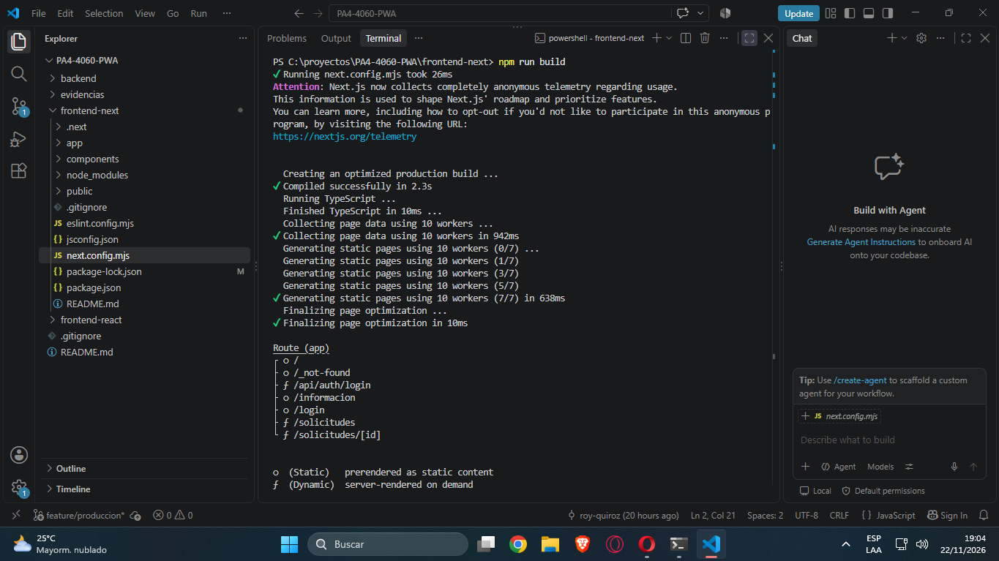

**Build con la configuración de producción:**

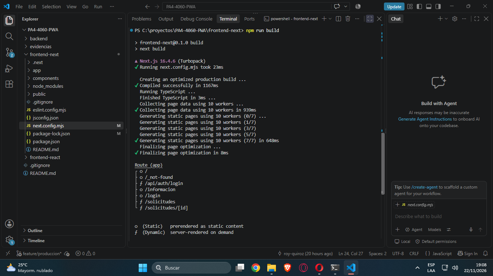

## 2. Webpack y Babel

Next.js 16 usa **Turbopack** como empaquetador por defecto (sucesor de Webpack) y **SWC** para transpilar (reemplazo de Babel). El proyecto no tiene `.babelrc`: crearlo desactivaría SWC y haría el build más lento. La única configuración de bundler necesaria es `turbopack.rules`, que procesa el CSS con Tailwind. No se agregó un bloque `webpack` porque con Turbopack provocaría un error de build.

- Webpack/Turbopack: empaqueta el código, lo divide en fragmentos (chunks) y elimina código sin uso.
- Babel/SWC: convierte JavaScript moderno a una versión compatible con los navegadores.

## 3. Variables de entorno

| Archivo | Uso | ¿Se sube a Git? |
|---|---|---|
| `.env.example` | Plantilla sin valores | Sí |
| `.env.development` | `NEXT_PUBLIC_ENTORNO=desarrollo`, logs activos | Sí |
| `.env.production` | `NEXT_PUBLIC_ENTORNO=produccion`, logs activos | Sí |
| `.env.local` | `API_URL` de la máquina local | No (en `.gitignore`) |

- `API_URL` no lleva el prefijo `NEXT_PUBLIC_`, así que la URL del backend solo existe en el servidor y no llega al navegador.
- En producción, `API_URL` se configura en Vercel (Settings → Environment Variables) y no en el repositorio.
- Se retiró el `console.log` que imprimía `API_URL` en el login, para no exponer configuración del servidor.
- El pie de página muestra `Entorno: desarrollo` o `Entorno: produccion` para comprobar que cada entorno carga su configuración.

**Entorno de desarrollo (Next carga `.env.local` y `.env.development`):**

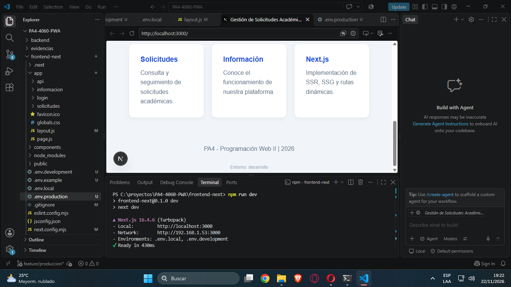

**Build de producción local (Next carga `.env.production`):**

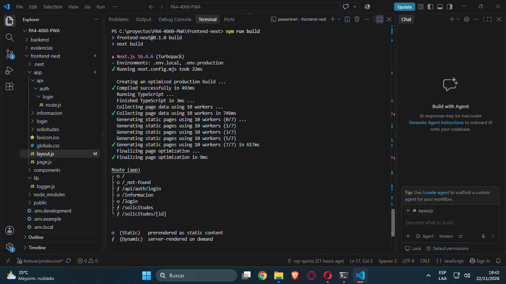

**Variable `API_URL` configurada en Vercel:**

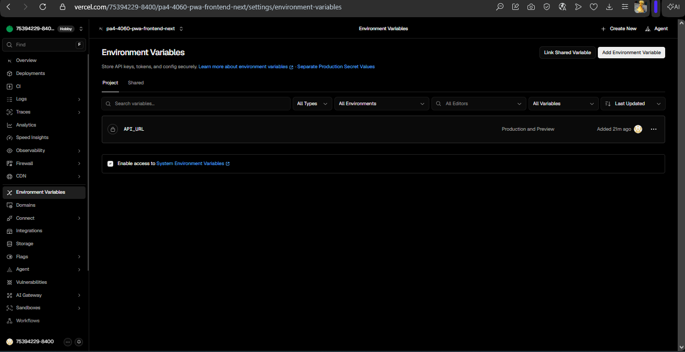

**Build en Vercel cargando `.env.production`:**

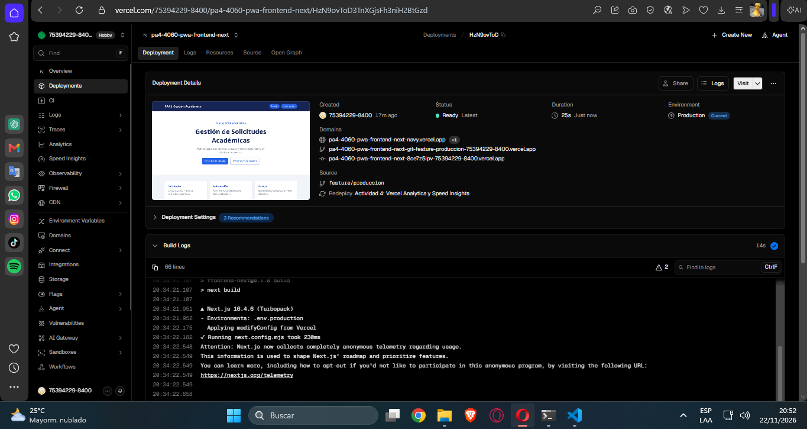

## 4. Logs

Se creó `lib/logger.js` con tres niveles (`info`, `warn`, `error`) y formato `[fecha ISO] [NIVEL] mensaje`. Los logs `info` se activan con `NEXT_PUBLIC_HABILITAR_LOGS`. Se aplicó en `app/api/auth/login/route.js`, sin registrar correos, contraseñas ni tokens.

**Logs en la terminal local:**

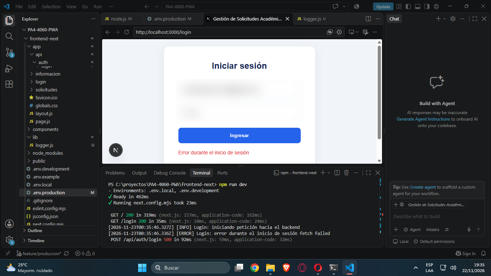

**Runtime Logs en producción (Vercel):**

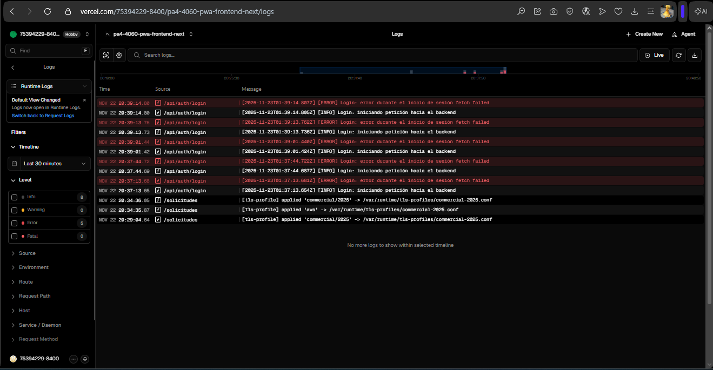

## 5. Monitoreo

Se instalaron `@vercel/analytics` y `@vercel/speed-insights` y se agregaron `<Analytics />` y `<SpeedInsights />` en `app/layout.js`.

- **Analytics:** visitantes, páginas vistas y rutas más visitadas.
- **Speed Insights:** Real Experience Score medido con usuarios reales.
- **Runtime Logs:** logs del servidor en tiempo real.

**Speed Insights:**

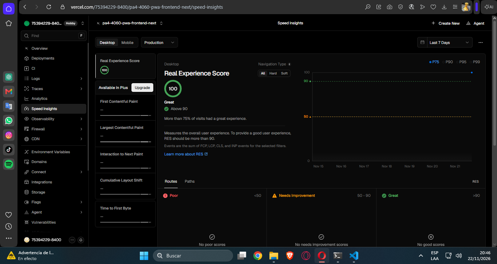

**Analytics:**

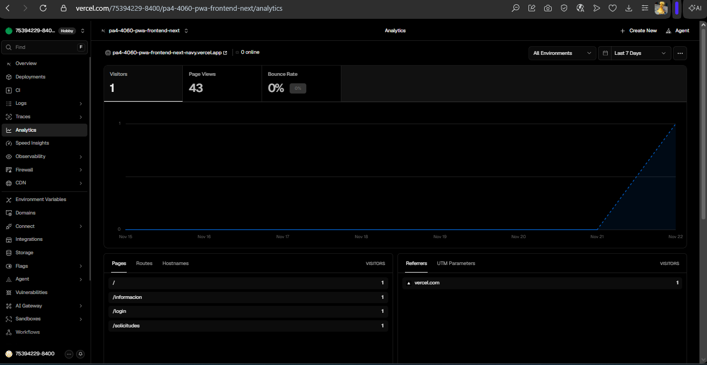

**Despliegues en producción:**

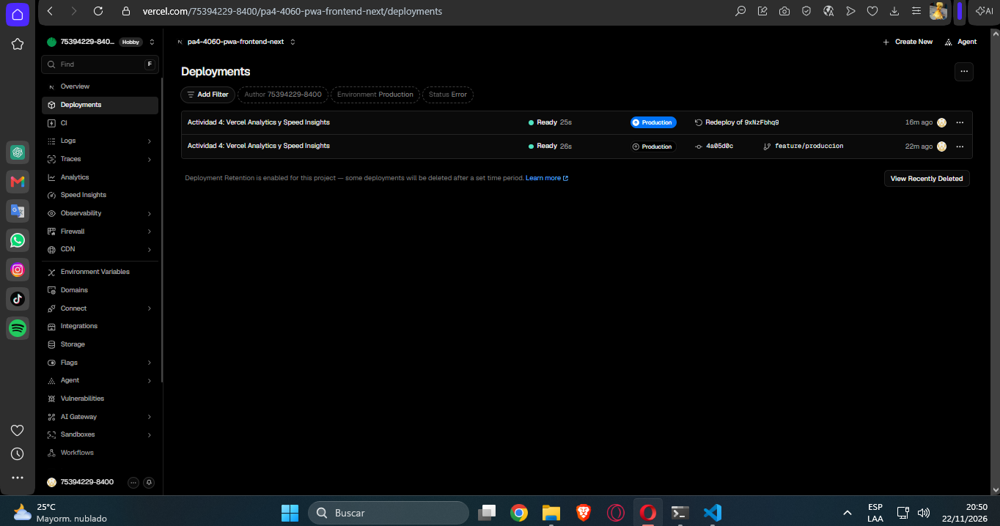

> Nota: las capturas de monitoreo provienen de un despliegue propio del mismo código (fork del repositorio) porque el plan gratuito de Vercel no permite invitar colaboradores al proyecto del equipo.

## 6. Integración con el equipo

Los cambios se entregaron mediante un Pull Request desde la rama `feature/produccion`, con los checks de Vercel en verde.

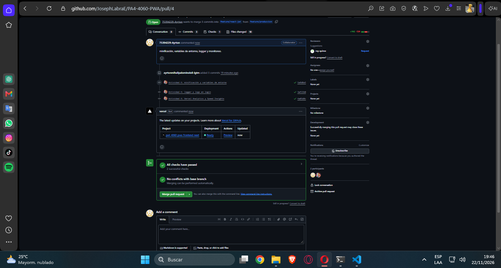

## Cómo reproducirlo

1. `cd frontend-next`
2. Crear `.env.local` con `API_URL=<url del backend>`
3. `npm install`
4. Desarrollo: `npm run dev`. Producción: `npm run build` y `npm start`.

## Conclusión

La aplicación quedó preparada para producción: build optimizado, configuración separada por entorno sin exponer secretos, logs con formato uniforme y monitoreo activo en Vercel.